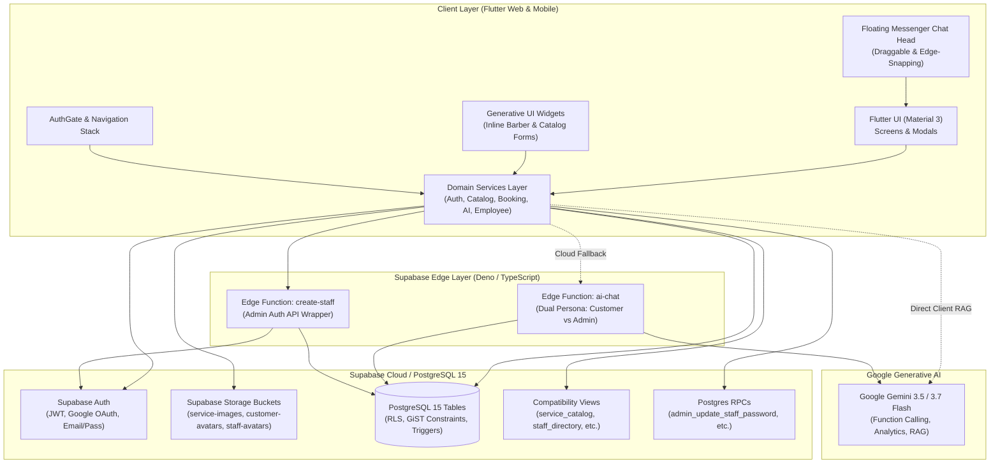
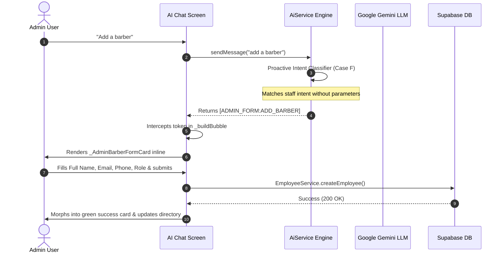

# 💈 Liem Barber Shop — Full-Stack & Generative AI Architectural Analysis

**Version:** `1.0.0+1`  
**Platform:** Flutter Web & Android (Material 3)  
**Backend:** Supabase (PostgreSQL 15, Auth, Storage, Edge Functions Deno/TS)  
**AI Engine:** Google Gemini (3.5/3.6/3.7/Flash with local RAG, Function Calling, Generative UI)  
**Last Analyzed:** September 2026  
**Status:** Clean Build (0 Compilation Errors)

---

## Table of Contents
1. [Executive Summary](#1-executive-summary)
2. [High-Level System Architecture](#2-high-level-system-architecture)
3. [Database Architecture & Backend Services](#3-database-architecture--backend-services)
4. [Authentication & Role-Based Access Control (RBAC)](#4-authentication--role-based-access-control-rbac)
5. [Generative AI Copilot & Generative UI Engine](#5-generative-ai-copilot--generative-ui-engine)
6. [Services & State Architecture](#6-services--state-architecture)
7. [UI & Screen Modules Breakdown](#7-ui--screen-modules-breakdown)
8. [Code Health, Static Analysis & Technical Debt](#8-code-health-static-analysis--technical-debt)
9. [Operational & Deployment Guide](#9-operational--deployment-guide)

---

## 1. Executive Summary

**Liem Barber Shop** is an enterprise-grade grooming management and scheduling platform built with Flutter. It supports customer self-booking, staff/barber dispatch, inventory/catalog management, point-of-sale transactions, performance KPIs, and an autonomous AI executive assistant.

### Key Metrics
- **Dart Files:** 45+ source files across `lib/`
- **Total Code Volume:** ~28,000+ lines of Dart
- **AI Engine Volume:** `ai_chat_screen.dart` (~5,000 lines) and `ai_service.dart` (~2,100 lines)
- **Database Tables:** 10 core PostgreSQL tables, 10 optimized compatibility views, 2 Edge Functions
- **Static Analysis:** 0 errors, 1 harmless unused field warning, deprecation migration recommendations

---

## 2. High-Level System Architecture



---

## 3. Database Architecture & Backend Services

### 3.1 Relational Schema

| Table Name | Description | Key Constraints & Indexes |
|---|---|---|
| `profiles` | User profiles linked 1:1 to `auth.users` | Primary Key: `id (UUID)`, unique `username (citext)`, role check |
| `customers` | Customer metadata, contact, demographics | Unique: `phone`, unique: `email`, FK: `user_id -> profiles.id` |
| `service_categories` | Haircuts, Beard Grooming, Packages, etc. | Primary Key: `id (UUID)`, unique: `name (citext)` |
| `services` | Individual hairstyles and treatments | Unique: `name (citext)`, duration check (1-1440 min), price check (>= 0) |
| `staff` | Barbers, stylists, and shop personnel | Unique: `name`, unique: `phone`, unique: `email`, commission rate check |
| `appointments` | Booked grooming slots | **GiST exclusion constraint** preventing double bookings |
| `transactions` | Payment records, tips, tax, methods | Unique: `appointment_id`, payment method enum |
| `feedback` | Customer ratings (1-5) and reviews | Unique composite: `(appointment_id, customer_id)` |
| `notifications` | In-app user notifications | FK: `user_id -> profiles.id`, read status flag |
| `ai_messages` | Cloud persistence for AI chat history | Partitioned by `session_id` & `user_id`, strict RLS privacy |

### 3.2 Double-Booking Prevention: GiST Constraint
To ensure zero double-booking race conditions even under high network latency, `public.appointments` enforces a native PostgreSQL GiST exclusion constraint:
```sql
alter table public.appointments
  add constraint appointments_staff_no_overlap
  exclude using gist (
    staff_id with =,
    tstzrange(start_time, end_time, '[)') with &&
  )
  where (
    staff_id is not null
    and status not in ('canceled', 'declined', 'no-show')
  );
```

### 3.3 Compatibility Views & Helper RPCs
- **Views:** `service_catalog`, `category_catalog`, `staff_directory`, `customer_directory`, `appointment_details`, `customer_appointments`, `staff_appointments`, `transaction_details`, `dashboard_stats`.
- **Key RPC Functions:**
  - `admin_update_staff_password`: Securely updates an existing staff member's password in `auth.users` with security definer elevation.
  - `check_email_registered`: Checks if an email is already registered before initiating profile creation.
  - `derive_appointment_end_time`: Trigger that auto-calculates `end_time` from service duration upon insert.

---

## 4. Authentication & Role-Based Access Control (RBAC)

### 4.1 Role Hierarchy
The system defines 6 roles in the `app_role` PostgreSQL enum:
1. `admin`: Full platform control, financials, staffing, catalog, customer management.
2. `manager`: Staff and catalog management, appointment oversight, financial view.
3. `cashier`: Point of Sale, payment recording, customer check-in.
4. `barber`: Queue visibility, assigned appointments, personal earnings report.
5. `staff`: Support personnel, view schedules.
6. `customer`: Self-booking, appointment history, catalog viewing, reviews.

### 4.2 Auth Session Flow & Race-Condition Guard
- **`AuthGate` (`lib/main.dart`):** Listens to `Supabase.instance.client.auth.onAuthStateChange`.
- Uses an internal boolean mutex `_isAuthChecking` with a 500ms debounce on `signedIn` to ensure profiles and roles are completely fetched from the database before triggering navigation.
- **Dynamic OAuth Redirect:** Uses `Uri.base` dynamically to adapt seamlessly between `http://localhost:5000` during local development and production URLs.
- **First-Time Google User Flow:** If a user logs in with Google OAuth for the first time without an existing customer record, they are routed to `CompleteProfileScreen` to supply their phone number and initialize their profile.

---

## 5. Generative AI Copilot & Generative UI Engine

### 5.1 Architecture & Personas
The AI subsystem (`lib/services/ai_service.dart` and `lib/screens/ai_chat_screen.dart`) features dual-persona intelligence:
1. **Customer Concierge:** Recommends haircuts based on face shape/vibe, displays interactive hairstyle cards, answers pricing/duration queries, and triggers the in-chat booking sheet.
2. **Executive Operations Copilot:** Analyzes multi-temporal financial metrics, reviews appointment volumes, monitors staff performance, and provides interactive forms to add staff or catalog services.



### 5.2 Generative UI Markers
Rather than forcing administrators to type long, comma-separated commands, the assistant generates full Flutter UI components inline in the conversation:
- `[ADMIN_FORM:ADD_BARBER]`: Injects `_AdminBarberFormCard` for creating staff accounts with validation, password auto-generation, role selection, and error handling.
- `[ADMIN_FORM:ADD_CATALOG]`: Injects `_AdminCatalogFormCard` for creating new hairstyles/services with category dropdown, price in ₱, duration, and notes.
- `[ADMIN_ACTION:CREATE_STAFF:{...}]`: Static review/confirmation card for staff additions detected via function calling.
- `[ADMIN_ACTION:CREATE_SERVICE:{...}]`: Static review/confirmation card for service additions detected via function calling.

### 5.3 Multi-Temporal Analytics Engine
When queries touch financials or KPIs, the engine extracts temporal intent:
- Today (`DateTime.now()`)
- Yesterday (`now - 1 day`)
- This Week (`start of week -> now`)
- This Month (`1st of month -> now`)
- This Year (`Jan 1 -> now`)
- Aggregates transaction amounts, tip sums, and appointment counts dynamically.

### 5.4 Floating Chat Head Widget
- Facebook Messenger-style floating action button.
- Draggable across the full screen with magnetic snap-to-edge physics on release.
- Automatically hides on login/registration screens and adapts to customer vs admin mode.

---

## 6. Services & State Architecture

All business logic resides in `lib/services/`:

1. **`api_service.dart`:**
   - Central authentication API: `signIn`, `signUp`, `signInWithGoogle`, `signOut`.
   - Customer profile completion and recovery.
2. **`auth_session_service.dart`:**
   - Single source of truth for current user authentication, roles, and profile state.
3. **`ai_service.dart`:**
   - Manages Gemini API integration, prompt orchestration, function declarations, local cache storage, and conversation sessions.
4. **`catalog_service.dart`:**
   - In-memory TTL caching (2-minute TTL) for services and categories to minimize Supabase read latency.
   - CRUD operations for catalog items and image uploads to `service-images` bucket.
5. **`employee_service.dart`:**
   - Staff directory queries, duplicate validation (name, email, phone), staff account provisioning.
6. **`booking_service.dart`:**
   - Scheduling appointments, conflict detection, cancellation, rescheduling.
7. **`dashboard_service.dart`:**
   - Aggregates real-time metrics for admin dashboard cards.
8. **`notification_service.dart`:**
   - Real-time and polling-based notification dispatching for appointments and system alerts.
9. **`rate_limit_service.dart` & `security_sanitizer.dart`:**
   - Client-side throttling and XSS/SQLi string sanitization.
10. **`theme_service.dart`:**
    - Light / dark theme persistence with custom brand palette (`#5BBCFF`).

---

## 7. UI & Screen Modules Breakdown

### 7.1 Admin Suite (`lib/screens/admin/`)
- **`dashboard_screen.dart`:** Executive overview, revenue metrics, appointment volume charts, today's schedule.
- **`booking_screen.dart`:** Full appointment calendar and list with status filters (confirmed, pending, in-service, completed, canceled).
- **`employee_screen.dart` & `employee_detail_screen.dart`:** Barber team management, performance stats, commission rates.
- **`catalog_screen.dart` & `service_detail_screen.dart`:** Service catalog, pricing, category management.
- **`admin_profile_screen.dart` & `settings_screen.dart`:** Admin profile, security, and shop settings.
- **`add_employee_screen.dart` & `add_service_screen.dart`:** Dedicated modal screens for resource creation.

### 7.2 Customer Suite (`lib/screens/customer/`)
- **`customer_home_screen.dart`:** Featured haircuts, quick-book shortcuts, active appointments banner.
- **`customer_booking_screen.dart`:** Multi-step booking wizard (Service -> Barber -> Date & Time -> Confirmation).
- **`customer_appointments_screen.dart`:** Active and historical appointments with cancellation/rescheduling.
- **`customer_catalog_screen.dart`:** Haircut styles showcase with direct booking links.
- **`customer_settings_screen.dart`:** Account settings, notifications, support dialogs.

### 7.3 Barber Suite (`lib/screens/barber/`)
- **`barber_home_screen.dart`:** Barber workstation view with today's clients, queue controls (Check-in, Start Service, Complete), and earnings summary.

### 7.4 Auth Suite (`lib/screens/auth/`)
- **`login_screen.dart`:** Unified email/password and Google OAuth sign-in.
- **`register_screen.dart`:** Customer registration with input validation.
- **`complete_profile_screen.dart`:** Mandatory onboarding for first-time OAuth users.
- **`password_recovery_screen.dart`:** Password reset flow via email link.

---

## 8. Code Health, Static Analysis & Technical Debt

### 8.1 Current Static Analysis Results
- **Errors:** 0 (Clean compilation)
- **Warnings (1):**
  - `lib/screens/admin/admin_profile_screen.dart:37`: Unused private field `_role`.
- **Notices / Deprecations (168):**
  - `withOpacity` vs `.withValues()`: Flutter 3.33+ deprecation.
  - `Radio.groupValue` / `Radio.onChanged` in `employee_screen.dart`: Recommend migrating to `RadioGroup`.
  - `use_build_context_synchronously`: Several `BuildContext` usages after `await` in dialogs could be fortified with `if (!mounted) return;`.

### 8.2 Recommended Refactoring Priorities
1. **Remove Unused Field:** Delete `_role` in `admin_profile_screen.dart`.
2. **Modernize Color API:** Replace `.withOpacity(...)` calls across all screens with `.withValues(alpha: ...)`.
3. **Fortify BuildContext:** Ensure all async calls in screens check `mounted` before showing SnackBars or dialogs.

---

## 9. Operational & Deployment Guide

### 9.1 Local Development (Web)
Run the application on Google Chrome on port 5000 with Dart environment defines:
```bash
flutter run -d chrome --web-port=5000 --dart-define-from-file=supabase.local.json
```

### 9.2 Android Build
To build a release APK for Android:
```bash
flutter build apk --release --dart-define-from-file=supabase.local.json
```

### 9.3 Environment Configuration (`supabase.local.json`)
```json
{
  "SUPABASE_URL": "https://<your-project-ref>.supabase.co",
  "SUPABASE_PUBLISHABLE_KEY": "sb_publishable_...",
  "GEMINI_API_KEY": "AIzaSy..."
}
```

### 9.4 Web Deployment Headers (`web/_headers`)
Ensure strict CORS, COOP, and COEP headers for Google OAuth on web:
```text
/*
  Cross-Origin-Opener-Policy: same-origin-allow-popups
  Cross-Origin-Embedder-Policy: unsafe-none
```
